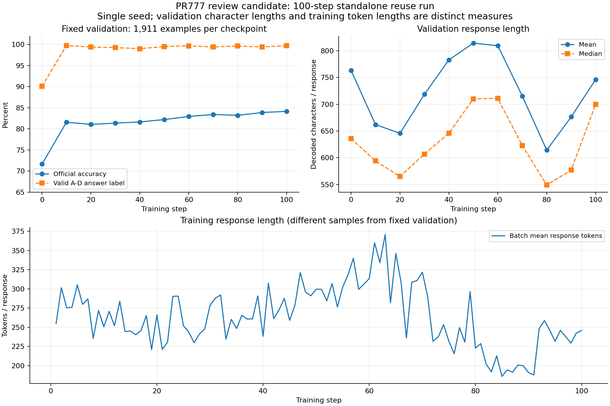
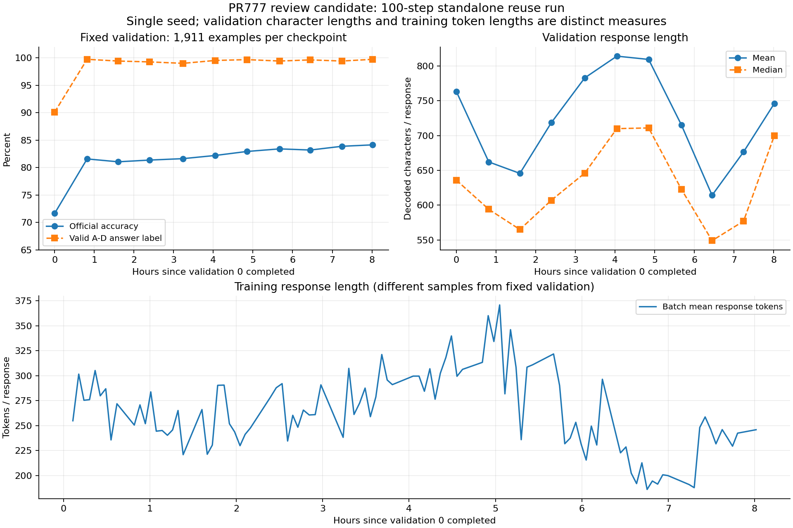
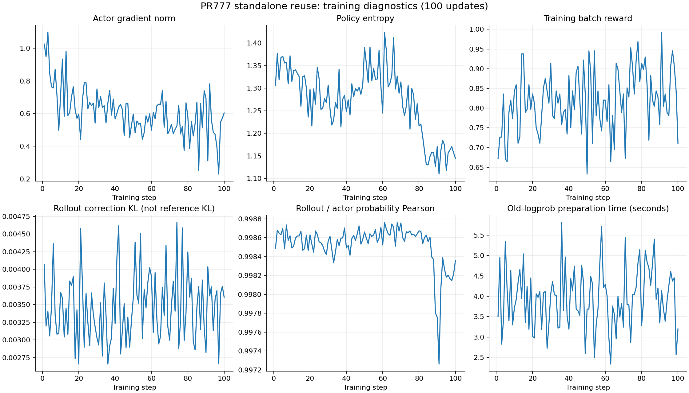

# PR777: AVQA reuse validation

Aggregate results for the review candidate's standalone 100-update reuse run. The plots show all 100 training updates and all 11 fixed validation checkpoints (steps 0, 10, ..., 100; 1,911 examples each).

- Hardware: eight H800 GPUs. One seed, one online trajectory.
- All 100 updates recorded nonzero gradients and enabled proximal reuse. All 93 scalar tags were finite.
- Official reward re-evaluation matched all 21,021 validation outputs and 12,800 training outputs.
- Fixed-validation accuracy: 1,369/1,911 (71.6379%) to 1,608/1,911 (84.1444%).
- Valid A-D answer labels: 1,722/1,911 to 1,906/1,911. This measures legal answer labels, not an independent reasoning-quality assessment.
- Validation response length: mean 763.494 to 746.203 decoded characters; median 636 to 700. Length fluctuates, including a dip at step 80 followed by a rebound.
- Validation 0 to validation 100 took 28,862.5303 seconds. The wall-time axis starts when validation 0 completed, excluding startup and validation 0. It includes subsequent training and validation; it is not training-only throughput.

The CSV files contain the aggregate series used in the plots. Validation lengths are decoded character counts; training lengths are response token counts on different sampled batches. Training batch reward is separate from fixed-validation accuracy. The plotted KL is rollout correction KL; reference KL was disabled and is N/A.

This is not a matched baseline/reuse comparison, a statistical-equivalence result, or a causal diagnosis of historical response shortening. The later checkpoint movement guard was tested separately with the current one-step recipe and native actor failure-boundary checks; the 100-step run did not include that later guard. Tests used an isolated development dependency combination, not unmodified public dependency pins. DataLoader teardown tracebacks, AccumulateGrad warnings and manager residual-process cleanup were retained in the underlying logs; successful completion does not mean a warning-free shutdown.

Figures are derived from a SHA-verified archived metrics file. They omit the answer-only panel for presentation; the original local evidence remains unchanged. No model weights, per-example generations, media, or optimizer snapshots are included here. Plot preparation used AI assistance and was checked against the archived aggregate metrics.
